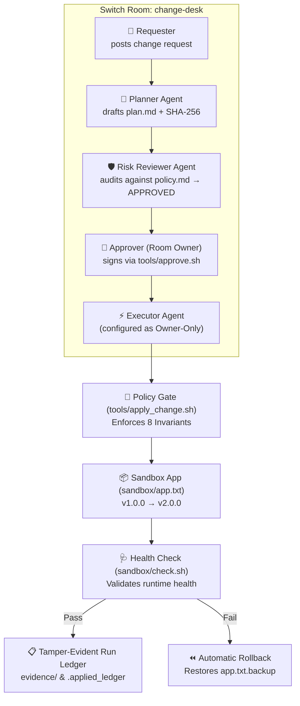

# Change Desk

> **Give every AI-assisted change a tamper-evident paper trail: request → plan → review → human approval → execution → health check. Make skipping a step impossible at the gate.**

Built for the **Switch Hackathon** (Track 1: Best Business Workflow) using [Switch](https://github.com/sandbox-quantum/switch) and [Antigravity](https://antigravity.google).

---

## The Problem

Production changes in AI-assisted teams are fast, but accountability is fragile. When an AI agent can execute changes directly, three failure modes routinely occur:
1. **Unreviewed changes:** An agent acts directly on a prompt without architectural critique or rollback planning.
2. **Untracked approvals:** Changes are applied without a verifiable record of who approved what.
3. **Plan drift & tampering:** The code that actually runs differs from the plan that was discussed and approved.

A single unreviewed change can lead to silent data corruption, broken downstream services, and hours of forensic debugging.

---

## Architecture

The workflow is anchored inside a **Switch room** where specialized agents collaborate in view of the room owner. A deterministic local script (`tools/apply_change.sh`) acts as an invariant gate:



### Two Layers of Defense

1. **Switch Access Control (Room Layer):**
   The Executor agent is **configured as owner-only** in Switch room settings. Messages from unauthorized participants or guests are rejected by Switch before reaching the agent.
2. **Deterministic Policy Gate (Filesystem & Gate Layer):**
   `tools/apply_change.sh` is a deterministic bash gate that refuses to apply any change unless all 8 invariants hold:
   - Change ID strictly matches `CHG-YYYYMMDD-NNN`.
   - Replay check passes (change has not already been executed).
   - Target version adheres to SemVer (`vX.Y.Z`).
   - Human approval file exists and references the matching Change ID.
   - SHA-256 digest of `plan.md` matches the approved fingerprint prefix.
   - Review file exists, verdict is `APPROVED`, and review's recorded `Plan Hash` matches the plan.
   - If an operator key is present, human HMAC signature is verified.
   - Target file is strictly contained inside `sandbox/` (no `..` traversal, no escaping symlinks).

---

## Honest Security Boundaries & Limitations

We keep our security claims strictly grounded:

- **Role separation is instructional:** In this setup, Planner, Reviewer, and Executor agents are separated by prompt instructions and Switch addressing roles. Any agent with direct filesystem write access could theoretically modify files directly. In production, this should be paired with OS-level container isolation per agent.
- **Operator key & residual risk:** The HMAC key (`~/.config/change-desk/operator.key`) is stored outside the repo to protect against prompt-level injection, accidental forgery, or agents writing approvals from the room. However, because agents and the operator run under the same OS user in this prototype, same-user file read access remains a residual risk. In production, this is closed by running agents under unprivileged accounts or using WebAuthn / hardware keys (YubiKey).
- **Switch owner-only setting:** The Executor's access is configured as owner-only in Switch room settings. Until tested with multiple physical accounts, we claim this as "configured as owner-only," not "cryptographically verified against a hostile model."
- **Sandbox containment:** `sandbox/app.txt` serves as a stand-in for infrastructure state, database schema, or microservice configuration. The gate protects the target path from directory traversal, but does not isolate arbitrary system commands.
- **Evidence auditability:** Audit records in `evidence/` are tamper-evident via SHA-256 fingerprints and run ledgers, not immutable hardware storage.

---

## Repo Structure

```
switch-change-desk/
  README.md                         ← you are here
  switch-change-desk.template.yaml  ← One-step Switch room creation template
  room-instructions.md              ← Workflow instructions pasted into Switch room
  Makefile                          ← Convenience targets for tests, demos, and reset
  agents/
    planner.md                      ← Planner agent instructions
    reviewer.md                     ← Risk Reviewer agent instructions
    executor.md                     ← Executor agent instructions (owner-only)
  policy/
    change-policy.md                ← Room knowledge file attached to Switch room
  sandbox/
    app.txt                         ← Target app state (stand-in for production config)
    check.sh                        ← Health check script with format validation
  tools/
    apply_change.sh                 ← Deterministic policy gate (8 invariant checks)
    approve.sh                      ← Human approval CLI with HMAC signature generation
    test_gate.sh                    ← 21-test automated regression suite
    offline_sim.sh                  ← Offline simulation harness for CI/local testing
  demo/
    script.md                       ← 2.5-minute video recording script (5 beats)
    reset.sh                        ← Idempotent cold-state reset script
    run_happy_path.sh               ← Offline fixture demo: happy path (v1.0.0 → v2.0.0)
    run_tamper_beat.sh              ← Offline fixture demo: tamper detection (hash mismatch)
    run_rollback_beat.sh            ← Offline fixture demo: health check failure auto-rollback
    fixtures/                       ← Pre-verified fixture files
  examples/evidence/
    CHG-DEMO-001/                   ← Committed complete audit trail of a real run
  docs/
    prd.md                          ← Product Requirements Document
    mvp.md                          ← MVP Scope and Acceptance Criteria
    plan.md                         ← Engineering Build Plan & Phase Tracking
    agent-design.md                 ← Multi-agent interaction specification
    SUBMISSION.md                   ← Hackathon submission package
    blog.md                         ← #HowISwitch blog post draft
```

---

## Setup & Switch Reproducibility (< 5 minutes)

### Prerequisites
- [Antigravity](https://antigravity.google)
- [Switch Console](https://github.com/sandbox-quantum/switch) installed and signed in
- Bash (macOS/Linux or WSL) with `openssl`

### Option A: One-Step Room Template Import

1. Open **Switch Console**.
2. Open the **Templates** tab, choose **Run Template**, and select or paste [`switch-change-desk.template.yaml`](switch-change-desk.template.yaml).
3. Switch automatically configures:
   - Room name: `change-desk`
   - Room instructions: [room-instructions.md](room-instructions.md)
   - Planner agent (`@change-desk-planner`): `addressing: anyone`
   - Risk Reviewer agent (`@change-desk-reviewer`): `addressing: anyone`
   - Executor agent (`@change-desk-executor`): `addressing: owner` (only the room owner can address this agent)

### Option B: Manual Room Configuration

1. Create a room named `change-desk` in Switch Console.
2. Add room instructions from [room-instructions.md](room-instructions.md).
3. Create 3 agents with their respective instructions:
   - **Planner:** instructions from [agents/planner.md](agents/planner.md), addressing set to `Anyone`
   - **Risk Reviewer:** instructions from [agents/reviewer.md](agents/reviewer.md), addressing set to `Anyone`
   - **Executor:** instructions from [agents/executor.md](agents/executor.md) → **set Addressing to `Owner`**.

---

## Running the Demo

### Live Switch Room Walkthrough (Follows `demo/script.md`)

1. **Requester posts in Switch room:**
   ```
   @change-desk-planner Change request: CHG-20261104-001
   What: Bump sandbox app from v1.0.0 to v2.0.0
   Target: sandbox/app.txt
   Target version: v2.0.0
   ```
2. **Planner produces plan:**
   Planner writes `evidence/CHG-20261104-001/plan.md`, computes hash via `./tools/hash_plan.sh`, and announces:
   `@change-desk-reviewer PLAN READY: CHG-20261104-001 (Plan SHA-256: <hash>). Please review according to change policy.`
3. **Risk Reviewer audits plan:**
   Reviewer audits `plan.md` against `policy/change-policy.md`, records the 64-hex `## Plan Hash` in `evidence/CHG-20261104-001/review.md`, and announces:
   `REVIEW READY: CHG-20261104-001 — APPROVED (Plan Hash: <hash>). Awaiting human operator sign-off.`
4. **Human reviews & signs approval:**
   In your terminal, run:
   ```bash
   ./tools/approve.sh CHG-20261104-001 v2.0.0
   ```
   This displays the complete plan and review, asks for interactive `approve` confirmation on TTY, validates plan binding, signs an operator HMAC token binding `ID:PlanHash:Version`, and outputs:
   `@change-desk-executor APPROVED CHG-20261104-001 <hash-prefix>`
5. **Approver replies in Switch room:**
   Post the exact output line:
   `@change-desk-executor APPROVED CHG-20261104-001 <hash-prefix>`
6. **Executor invokes gate:**
   The Executor (gated by `addressing: owner`) runs:
   ```bash
   ./tools/apply_change.sh CHG-20261104-001 <hash-prefix> v2.0.0
   ```
   The gate validates all 8 invariants, applies the change, runs `sandbox/check.sh`, writes clean execution log, and announces:
   `EXECUTED: CHG-20261104-001 — check.sh PASSED`

---

## Offline Gate Regression Suite (No Switch Required)

To ensure the deterministic gate and rollback mechanisms can be validated in CI and by evaluators offline, we provide a complete regression harness:

```bash
# 1. Run the comprehensive 21-test gate regression suite
make test

# 2. Run the offline happy path demo fixture (v1.0.0 → v2.0.0)
make demo-happy

# 3. Run the tamper detection demo (post-approval edit is rejected)
make demo-tamper

# 4. Run the automatic rollback demo (runtime check failure reverts app)
make demo-rollback

# 5. Run the offline simulation harness
make sim

# 6. Run the entire offline CI suite
make ci
```

### 21 Regression Tests Implemented

| # | Test Case | Expected Outcome |
|---|---|---|
| 1 | Happy path execution | Exits 0, `v1.0.0 → v2.0.0`, `check.sh PASSED` |
| 2 | Post-approval plan tampering | Exits 1 with `HASH MISMATCH` |
| 3 | Full hash mismatch against signed hash | Exits 1, detects prefix vs 64-hex divergence |
| 4 | Unsigned approval fails closed | Exits 1, rejects missing `hmac_sig` |
| 5 | Invalid / forged HMAC signature | Exits 1, detects invalid signature |
| 6 | Target version mismatch against signature | Exits 1, rejects unauthorized version |
| 7 | Short hash prefix (< 8 hex chars) | Exits 1 immediately on prefix length |
| 8 | Malformed Change ID creates no files | Exits 1 without touching filesystem |
| 9 | Missing `approval.txt` | Exits 1 with `Approval file not found` |
| 10 | Approval Change ID mismatch | Exits 1 with `Approval ID mismatch` |
| 11 | Missing `review.md` | Exits 1 with `Review file not found` |
| 12 | Reviewer verdict `REJECTED` | Exits 1 with `verdict is not APPROVED` |
| 13 | Missing `## Plan Hash` in review | Exits 1 with missing plan hash section |
| 14 | Malformed review plan hash | Exits 1 with non-64-hex review hash |
| 15 | Stale review / review-to-plan mismatch | Exits 1 with review plan hash mismatch |
| 16 | Dynamic path traversal escape attempt | Exits 1 with containment violation |
| 17 | Symlink escape outside sandbox | Exits 1 with symlink escape detected |
| 18 | Replay attack (reusing approval) | Exits 1 with `REPLAY DETECTED` |
| 19 | Health check failure auto-rollback | Exits 1, reverts sandbox to `v1.0.0` |
| 20 | Clean log output | Exits 0, strips ANSI color escapes from log |
| 21 | Approve CLI `--yes` refusal | Exits 1, refuses `--yes` bypass flag |

---

## Inspecting Sample Evidence

Judges and evaluators can inspect a complete, pre-recorded audit trail in [`examples/evidence/CHG-DEMO-001/`](examples/evidence/CHG-DEMO-001/):
- `plan.md` — Scoped plan with rollback procedure and risk rating
- `review.md` — Review verdict cryptographically bound to plan hash
- `approval.txt` — Human approval record with HMAC signature
- `execution.log` — Full deterministic gate execution trace
- `app.txt.backup` — Preserved pre-change state
- `audit-verdict.json` — Machine-readable compliance verdict

---

## Limitations & Next Steps

### Current Limitations
- **Instruction-based agent boundaries:** Planner and Reviewer are isolated by Switch instructions and addressing roles rather than hypervisor-level sandboxing.
- **Local operator secret:** `tools/approve.sh` generates a local operator secret on the host machine (`~/.config/change-desk/operator.key`).
- **Single-target sandbox:** The target resource is a simulated application state file in `sandbox/app.txt`.

### Next Steps
1. **Hardware Security Module (HSM) / WebAuthn:** Bind `tools/approve.sh` to a YubiKey or TouchID via WebAuthn/FIDO2.
2. **Containerized Agent Sandboxing:** Run each Switch agent inside an ephemeral Docker container with read-only filesystem mounts.
3. **CI/CD Integration:** Webhook bridge connecting Switch approval announcements directly to GitHub Actions deployment environments.

---

## License

MIT License. Built for the Switch Hackathon 2026.
