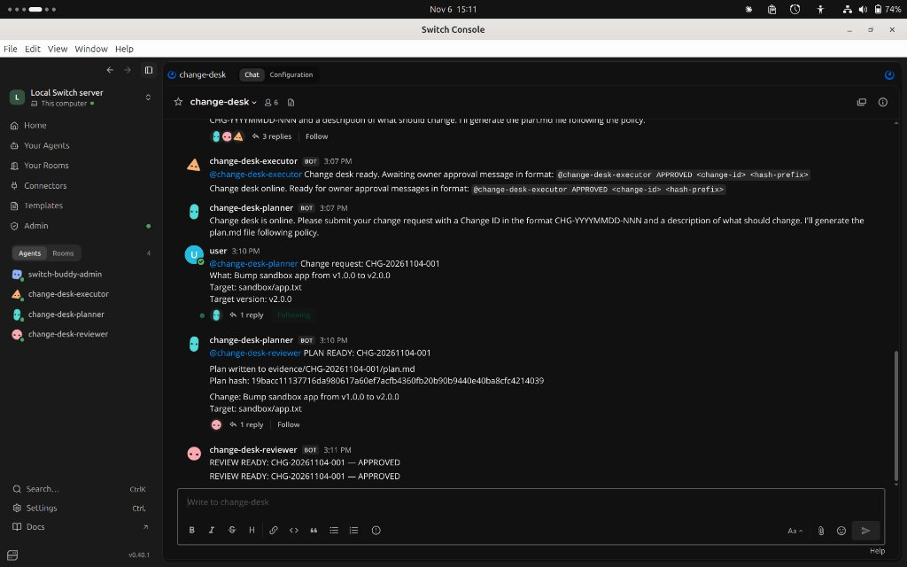
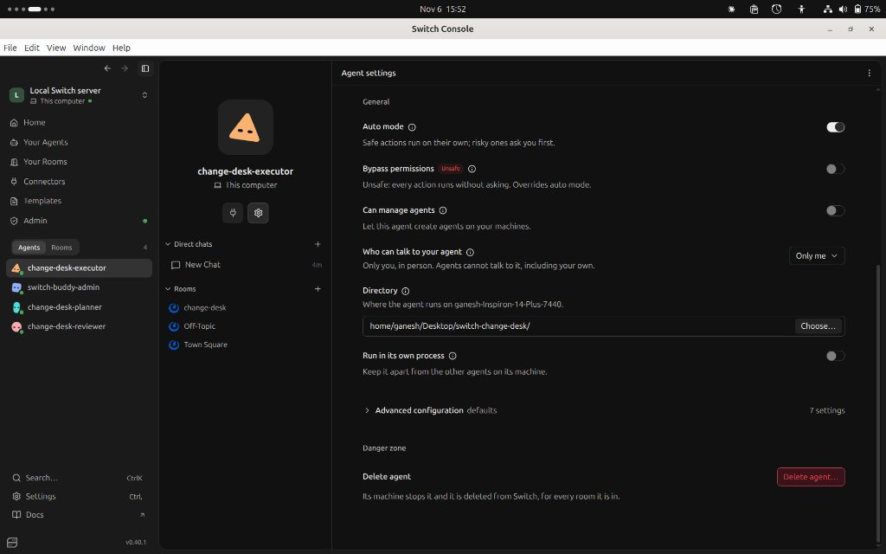
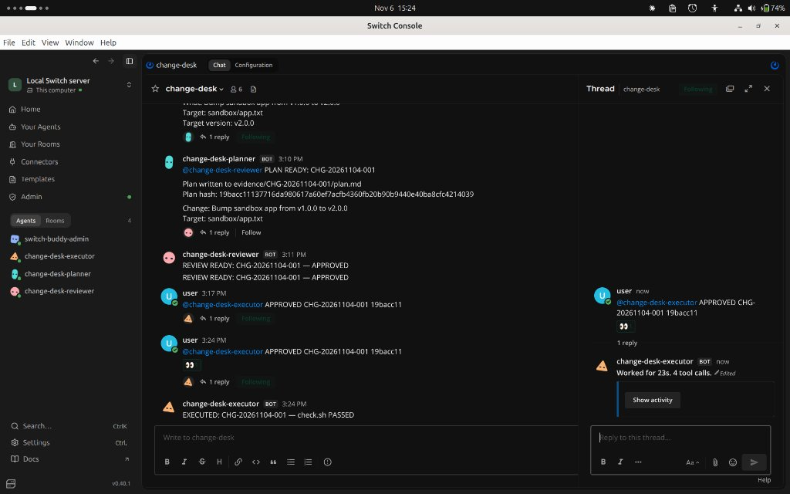

# How I Switched: a human-approved change desk for AI agents

*#HowISwitch — Flip the Switch Hackathon 2026*  
*Published on DEV Community: [https://dev.to/showspeed_i_caeaca59a9c74/how-i-switched-a-human-approved-change-desk-for-ai-agents-2mml](https://dev.to/showspeed_i_caeaca59a9c74/how-i-switched-a-human-approved-change-desk-for-ai-agents-2mml)*

When an AI agent can change a system with one prompt, speed is easy and accountability isn't. Who reviewed the plan? Who approved it? Was the plan that ran the plan that was approved? I built **Change Desk** during the Flip the Switch hackathon to answer those questions, solo, using Switch and Antigravity.

---

## What it does

A change request goes through a Switch room: request, plan, review, human approval, execution. Three agents share the room. A planner writes `plan.md`. A risk reviewer checks it against a policy file and records the plan's SHA-256 hash in `review.md`. An executor runs the change, and only after approval. The target is a small sandbox app, `v1.0.0` to `v2.0.0`, so nothing real is at risk.

---

## Where Switch fits

The room is the coordination layer. Agents hand work to each other by @mention, and the whole conversation is in one place. In the agent's settings, the executor's addressing is set to **Who can talk to your agent: Only me (`owner`)** (*"Only you, in person. Agents cannot talk to it, including your own"*). Switch decides who can instruct the executor. A small script decides whether the change is allowed to run.

---

## The gate

`tools/apply_change.sh` is deterministic. It refuses unless all of these hold: a well-formed change ID, no earlier execution of that ID in the append-only ledger (replay protection), a signed approval, a plan hash matching what was approved, a review bound to the same plan, a version matching what was signed, and a target inside the sandbox. After applying, it runs a health check and rolls back automatically on failure.

The human step is `tools/approve.sh`. It shows the full plan and review, asks for confirmation on a real terminal, and signs the change ID, plan hash, and version with an operator key.

---

## What the live run looked like

In our live run (`CHG-20261104-001`), I requested a version bump from `v1.0.0` to `v2.0.0`. The planner drafted the steps in `evidence/CHG-20261104-001/plan.md` and calculated the hash (`19bacc111377...`). The reviewer independently audited the plan against `policy/change-policy.md`, verified the hash, and posted its `APPROVED` verdict to the room.

I ran `./tools/approve.sh`, reviewed the un-truncated plan, approved it on my terminal, and posted the signed token back into the room. The executor picked it up, made **four tool calls**, and completed execution in **about 23 seconds**. Every step left evidence: plan, review, approval, and execution log. I committed a sanitized copy of this real run under `examples/evidence/live-run-CHG-20261104-001/` so anyone can inspect the exact artifacts without running anything.

---

## What went wrong first

- **Template schema mismatch caught in review:** My first draft had invented fields the format doesn't have, like top-level `version` and external file paths for instructions (`instructions: agents/planner.md`). I caught this before importing by comparing my draft to the official `triage-pair.template.yaml` example and running Switch's template linter (`tools/lint_template.py`). I fixed it by writing `tools/build_template.py` (run via `make template`) to automatically compile the agent markdown files into inline YAML following the official schema.
- **Adding explicit @mentions up front:** The official Switch example hands work off by name (*"Bugs go to the reproducer, by name"*). In my initial prompt draft, agents announced `PLAN READY: <id>` with no mention. Knowing agents in a room only trigger when addressed, I added explicit `@mentions` (`@change-desk-planner`, `@change-desk-reviewer`, `@change-desk-executor`) into the instructions before running live.
- **Designing against hash hallucinations:** Asking an LLM to compute a SHA-256 hash in its prompt context is a known failure mode that leads to truncated or hallucinated hex strings. If the reviewer's hash differed by a single byte, the gate would fail. I designed against this by creating `tools/hash_plan.sh` as a deterministic bash helper so agents run a script instead of guessing hashes.
- **Agent sandbox failure (`XDG_CONFIG_HOME`):** During the live run, the executor's first gate call actually failed-closed. Switch's agent runner isolates the execution environment, redirecting `XDG_CONFIG_HOME` to a temporary directory in `/tmp/switch-opencode-...`. The gate looked for `operator.key` in that temporary directory and refused: `GATE REFUSED: FAIL-CLOSED: Operator key missing at /tmp/.../operator.key`. I updated `apply_change.sh` to fall back to the user's home directory via `getent passwd` (a Linux-specific lookup), which allowed the sandboxed agent to verify the signature on the second attempt.

---

## Limits, honestly

This is a prototype in a sandbox. The agents and I run under the same OS account, so a determined same-user process could read the operator key. Because the gate runs inside the agent runner and currently uses symmetric HMAC, anything that verifies the signature can also read the key. The signature proves the key was used and guards against prompt injection or room-level accidental approvals, not a local agent inspecting the filesystem.

Switch's addressing is configured to owner; I did not test it against a second user account. Files in the evidence folder are tamper-evident via SHA-256 fingerprints and an append-only run ledger, not immutable hardware storage.

---

## Try it

- **Repository:** [https://github.com/gnshx/switch-change-desk](https://github.com/gnshx/switch-change-desk)
- **Offline tests:** Clone the repo and run `make test` (21 regression tests, runs in about 2 seconds).
- **Run in Switch:** Import `switch-change-desk.template.yaml` in Switch Console. **Setup note:** In the template dialog, ensure the `directory` parameter points to your clone (`/path/to/switch-change-desk`) so all agents and your terminal share the same working directory.

---

## What I'd do next

1. **Asymmetric signing:** Switch from symmetric HMAC to asymmetric signing (e.g. Ed25519 or `ssh-keygen -Y`). The human signs with a private key, and the gate verifies with a committed public key so the secret is never accessible to the agent runner.
2. **Multi-account testing:** Test Switch's addressing policy with a real second account to confirm outsider refusal on camera.
3. **Multi-provider reviewers:** Add a second reviewer agent powered by a different model provider to catch subtle edge cases.

Building with AI agents taught me that velocity is easy, but accountability has to be engineered. Switch gave me the collaborative room and addressing boundaries; the policy gate gave me deterministic certainty.
