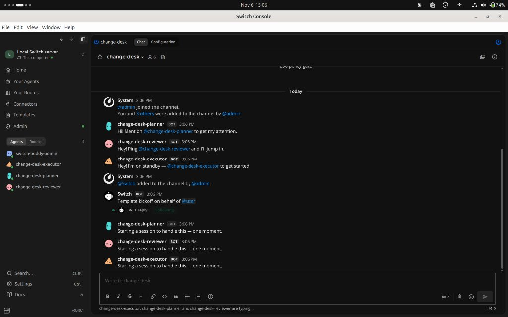

# How I Switched: a human-approved change desk for AI agents

*#HowISwitch — Flip the Switch Hackathon 2026*

When an AI agent can change a system with one prompt, speed is easy and accountability isn't. Who reviewed the plan? Who approved it? Was the plan that ran the plan that was approved? I built **Change Desk** during the Flip the Switch hackathon to answer those questions, solo, using Switch and Antigravity.

---

## What it does

A change request goes through a Switch room: request, plan, review, human approval, execution. Three agents share the room. A planner writes `plan.md`. A risk reviewer checks it against a policy file and records the plan's SHA-256 hash in `review.md`. An executor runs the change, and only after approval. The target is a small sandbox app, `v1.0.0` to `v2.0.0`, so nothing real is at risk.

---

## Where Switch fits

The room is the coordination layer. Agents hand work to each other by @mention, and the whole conversation is in one place. The executor's addressing is set to owner, so only the room owner is admitted to instruct it. Switch decides who can instruct the executor. A small script decides whether the change is allowed to run.

---

## The gate

`tools/apply_change.sh` is deterministic. It refuses unless all of these hold: a well-formed change ID, no earlier execution of that ID (replay protection), a signed approval, a plan hash matching what was approved, a review bound to the same plan, a version matching what was signed, and a target inside the sandbox. After applying, it runs a health check and rolls back automatically on failure.

The human step is `tools/approve.sh`. It shows the full plan and review, asks for confirmation on a real terminal, and signs the change ID, plan hash, and version with an operator key.

---

## What the live run looked like

In our live run (`CHG-20261104-001`), I requested a version bump from `v1.0.0` to `v2.0.0`. The planner drafted the steps in `evidence/CHG-20261104-001/plan.md` and calculated the hash (`19bacc111377...`). The reviewer independently audited the plan against `policy/change-policy.md`, verified the hash, and posted its `APPROVED` verdict to the room.

I ran `./tools/approve.sh`, reviewed the un-truncated plan, approved it on my terminal, and posted the signed token back into the room. The executor picked it up, made **four tool calls**, and completed execution in **about 23 seconds**. Every step left evidence: plan, review, approval, and execution log. I committed a sanitized copy of this real run under `examples/evidence/live-run-CHG-20261104-001/` so anyone can inspect the exact artifacts without running anything.

---

## What went wrong first

- **Template schema mismatch:** My initial template draft included invented keys like `version`, `handle`, and external file references like `instructions: agents/planner.md`. Switch Console's template parser rejected it immediately. I fixed this by aligning strictly with Switch's official template schema (`params`, `agents`, `room`, `kickoff`, and inline instructions) and created a compiler script (`tools/compile_template.py`) checked by Switch's internal linter.
- **Silent handoff stalls:** In collaborative rooms, agents only react when addressed. Early messages announced `PLAN READY` without an `@mention`, stalling the handoff. Making explicit mentions part of the room protocol (`@change-desk-planner`, `@change-desk-reviewer`, `@change-desk-executor`) made handoffs immediate.
- **Hallucinated plan hashes:** Asking an LLM to compute a SHA-256 hash in its head invariably leads to truncated or hallucinated hex strings. I built `tools/hash_plan.sh` as a deterministic bash helper so the agents run a script instead of guessing hashes.
- **Agent sandbox redirection (`XDG_CONFIG_HOME`):** Switch's agent runner isolates execution to a temporary folder in `/tmp/switch-opencode-...`. When the executor called `apply_change.sh`, the gate failed-closed because it looked for `operator.key` in the temporary config path. I updated `apply_change.sh` to fall back to the real user home directory via `getent passwd`, allowing sandboxed agents to locate the host operator key while keeping the fail-closed check intact.

---

## Limits, honestly

This is a prototype in a sandbox. The agents and I run under the same OS account (`ganesh`), so a determined same-user process could read the operator key. The signature guards against accidental and prompt-injected approvals, not a malicious local agent. Production use would need separate accounts or hardware-backed signing. Switch's addressing is configured to owner; I did not test it with a second user account. Files in the evidence folder are tamper-evident via SHA-256 fingerprints and run ledgers, not immutable hardware storage.

---

## Try it

- **Repository:** [https://github.com/gnshx/switch-change-desk](https://github.com/gnshx/switch-change-desk)
- **Offline tests:** Clone the repo and run `make test` (21 regression tests, runs in under 3 seconds).
- **Run in Switch:** Import `switch-change-desk.template.yaml` in Switch Console. **Setup note:** In the template dialog, ensure the `directory` parameter points to your clone (`/path/to/switch-change-desk`) so all agents and your terminal share the same working directory.

---

## What I'd do next

Per-role file permissions, separate OS users for each agent runner, and a second reviewer agent powered by a different model provider to catch subtle logic flaws.

Building with AI agents taught me that velocity is easy, but trust has to be engineered. Switch gave me the collaborative room and access boundaries; the policy gate gave me deterministic certainty. That combination makes autonomous operations safe enough to sleep through the night.
